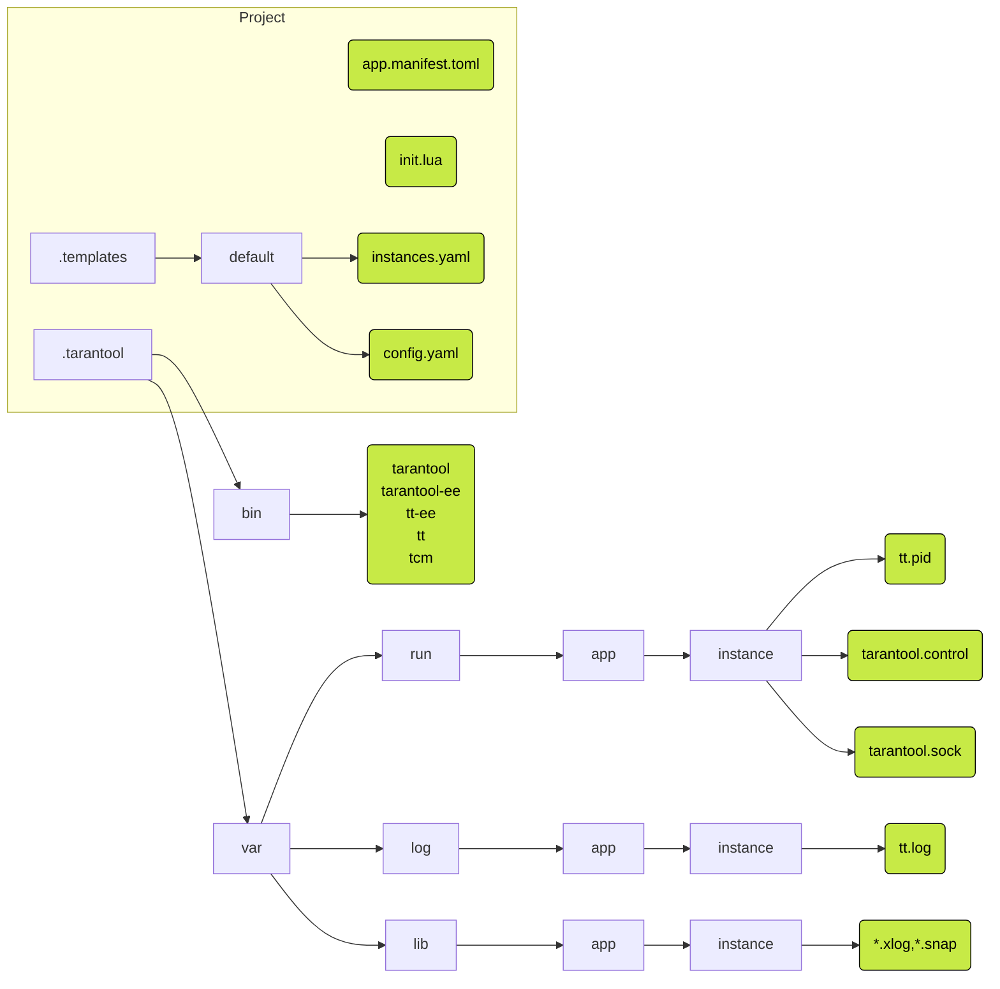
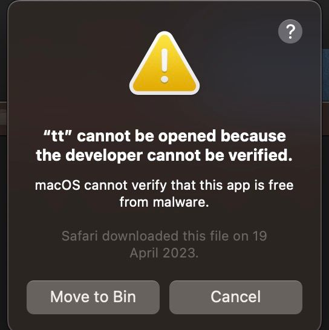
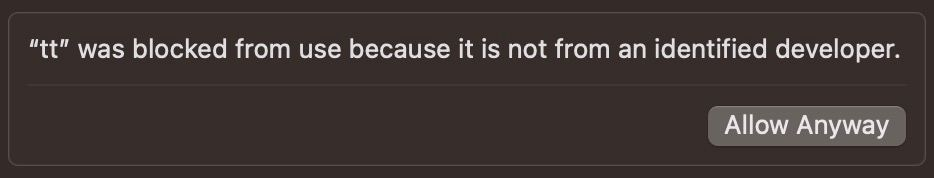

<!-- spell-checker:ignore testfull -->

<a href="http://tarantool.org">
  
</a>

# Tarantool CLI

> [!WARNING]
> The `v3` branch is under heavy development. Expect breaking changes and
> unstable APIs.

[![Go Reference][godoc-badge]][godoc-url]
[![Go Report][report-badge]][report-url]
[![Release][release-badge]][release-url]
[![Full CI][testing-actions-badge]][testing-actions-url]

Tarantool CLI - command line utility for managing Tarantool packages and
Tarantool-based applications.

## Contents

- [Intro](#intro)
- [Getting started](#getting-started)
  + [Installation](#installation)
  + [Build from source](#build-from-source)
    * [Prerequisites](#prerequisites)
    * [Build](#build)
    * [Dependencies](#dependencies)
    * [Run tests](#run-tests)
- [Configuration](#configuration)
  + [Binaries](#binaries)
  + [Rock servers](#rock-servers)
- [Migrating from instances.enabled](#migrating-from-instancesenabled)
- [External modules](#external-modules)
- [Building a distribution of tt](#building-a-distribution-of-tt)
  + [Building on another core](#building-on-another-core)
  + [Offline build](#offline-build)
- [CLI Args](#cli-args)
  + [Autocompletion](#autocompletion)
- [TT usage](#tt-usage)
  + [Working with a set of instances](#working-with-a-set-of-instances)
  + [Running instances under systemd](#running-instances-under-systemd)
  + [Working with application templates](#working-with-application-templates)
  + [Working with tt daemon (experimental)](#working-with-tt-daemon-experimental)
  + [Setting Tarantool configuration parameters via environment variables](#setting-tarantool-configuration-parameters-via-environment-variables)
- [Migration from older TT versions](doc/migration_from_older_versions.md)
- [Known issues](doc/known_issues.md)
- [Commands](#commands)

## Intro

`tt` is tarantool's instance and environment management utility and is used to
develop, deploy, run and operate an application.

One of the basic concepts that `tt` works with is the "project": the
directory of a tarantool application, with its `app.manifest.toml` or its
instance templates, `.templates/<name>/instances.yaml`. `tt` finds the project
from the current directory upward. The binaries the project runs on and the
runtime artifacts of its instances are in its `.tarantool` directory, apart
from other applications. There is no configuration file of the environment:
`tt.yaml` of `tt` 2.x is not read.

The example of a typical project:



## Getting started

### Installation

TT can be installed from the deb / rpm repository "tarantool/modules".

Install the tarantool repositories:

<https://www.tarantool.io/en/download/os-installation/>

Install TT:

- Deb based distributions:

``` console
apt-get install tt
```

- Rpm based distributions:

``` console
yum install tt
dnf install tt
```

On Gentoo Linux, the TT can be installed from the [Tarantool Gentoo
Overlay](https://github.com/tarantool/gentoo-overlay):

``` console
emerge tt
```

On MacOS, the TT can be installed from brew:

``` console
brew install tt
```

You can also install Tarantool CLI by downloading archive with pre-built
binary for your OS from GitHub's Releases page.

However, on MacOS to run that binary you will need to do additional
steps:

1. After first try to run binary, you will encounter an error:

    

1. To fix it, you should go to 'system settings-\>privacy and
    security', then scroll down and find:

    

1. Click on 'Allow Anyway' and you should be able to use Tarantool Cli.

### Build from source

#### Prerequisites

- [Go (version 1.18+)](https://golang.org/doc/install)
- [Mage](https://magefile.org/)
- [Git](https://git-scm.com/book/en/v2/Getting-Started-Installing-Git)

To run tests:

- [Python3](https://www.python.org/downloads/)
- [pytest](https://docs.pytest.org/en/7.2.x/getting-started.html#get-started)
- [ruff](https://pypi.org/project/ruff/)
- [golangci-lint](https://golangci-lint.run/usage/install/#local-installation)
- [lichen](https://github.com/uw-labs/lichen#install)
- [docker](https://docs.docker.com/engine/install/)
- [NodeJS](https://nodejs.org/en/download)
- [CMake](https://cmake.org/install/)
- [etcd 3+](https://etcd.io/docs/v3.5/install/)

#### Build

``` console
git clone https://github.com/tarantool/tt
cd tt
```

By default, tt uses the pure-Go TLS backend and does not require OpenSSL.
Use the explicit `default` value to override another exported build mode:

``` console
mage build
TT_CLI_BUILD_SSL=default mage build
```

To use the dynamically linked OpenSSL backend:

``` console
TT_CLI_BUILD_SSL=openssl mage build
```

To build a statically linked binary with the OpenSSL backend, install the
OpenSSL static libraries and run:

``` console
TT_CLI_BUILD_SSL=openssl_static mage build
```

#### Dependencies

**tt rocks runtime dependencies:**

- [curl](https://curl.se) or
    [wget](https://www.gnu.org/software/wget/)
- [zip](http://infozip.sourceforge.net/)
- [unzip](http://infozip.sourceforge.net/)

**tt binary install && search runtime dependencies:**

- [Git](https://git-scm.com/book/en/v2/Getting-Started-Installing-Git)

#### Run tests

Disable `etcd` service:

``` console
systemctl stop etcd
systemctl disable etcd
```

Create a virtual environment and install tests requirements:

``` console
python3 -m venv .venv

source .venv/bin/activate

pip install -r test/requirements.txt
```

Once inside the virtual environment, run default set of tests (excluding
slow tests):

``` console
mage test
```

To run full set of tests:

``` console
mage testfull
```

### Commit changes

The project uses [pre-commit](https://pre-commit.com/) to check code before committing.
After activating the virtual environment for [run tests](#run-tests), the `pre-commit`
hooks must be installed in the repository:

``` console
pre-commit install
```

Now you will perform automatic checks at every commit.
The first time you use `pre-commit` it will install the dependencies needed for
it to work, which may take some time. Subsequent runs will be much faster.

If errors were found, the commit will fail. If the errors can be corrected
automatically, you will receive modified files to add to the commit, checking
for correctness. In other cases you will get a message with errors that need to
be corrected manually.

## Configuration

`tt` has no configuration file. `tt.yaml` of `tt` 2.x is not read by any
command, and neither is `/etc/tarantool/tt.yaml`. What it configured is set
elsewhere:

- `env.bin_dir`, `env.inc_dir`: the binaries and headers `tt binary install`
    puts into a scope (see [Binaries](#binaries)). In a project the commands
    run the `tarantool` and `tcm` of `.tarantool/bin`, and otherwise the first
    on `PATH`.
- `env.output_history_max`: the argument of `\history` in the `tt connect`
    console, such as `\history 15` (10 without one).
- `env.restart_on_failure`: the `restart` field of the instance record.
- `app.*_dir`: the runtime artifacts of an instance go under the root of the
    scope of its application (see
    [Working with a set of instances](#working-with-a-set-of-instances)).
- `repo.rocks`: the rock servers of `tt registry` (see
    [Rock servers](#rock-servers)).
- `ee.credential_path`: the `--credentials-file` flag of `tt binary`.
- `templates`: `tt create` takes a template of your own by its path (see
    [Working with application templates](#working-with-application-templates)).
- `modules.directory`: `TT_CLI_MODULES_PATH` (see
    [External modules](#external-modules)).

### Binaries

`tt binary install`, `search`, `list`, `switch`, and `uninstall` for `tt`, `tarantool`,
`tarantool-ee`, `tt-ee`, `tcm`, and `tarantool-sdk` use `--scope project` (the default),
`user`, or `system` to choose the installation root. Executables are stored directly in
`versions/<product>/<product>_<version>/`, with Tarantool headers in its
`include/tarantool/` directory. Active executable links are in `bin/` and Tarantool
header links in `include/`. Each command uses only the selected scope, without
falling back to user/system installations. The project scope is `.tarantool` in
the project directory: the current directory or its nearest parent with
`app.manifest.toml` or `.templates/<name>/instances.yaml`, and the current
directory outside a project. `TT_USER_ROOT` and `TT_SYSTEM_ROOT` replace the
default user and system roots and must be absolute paths. For `search`, the
scope only selects the installed/active labels; it does not change the source
of available versions.

`tt binary install tarantool` supports Community Edition releases starting
with Tarantool 3.0.

The first successful `tt binary install` in project scope creates
`.env/activate.sh` and `.env/deactivate.sh` in the project directory. Existing
scripts are preserved.
Run `source .env/activate.sh` to set `TT_PROJECT_DIR` to the installation's
project directory, prepend `.tarantool/bin` to `PATH`, and set
`TT_CLI_TARANTOOL_PREFIX` to the project's `.tarantool` directory. The prefix
selects the active headers in `.tarantool/include/tarantool`.
Run `source .env/deactivate.sh` to restore the previous `PATH` and Tarantool
prefix and unset the project variables. User and system installations do not
create these scripts.

Installing `tarantool-sdk` installs Tarantool Enterprise, tt Enterprise, TCM, and
headers from one SDK archive. The `tt-ee` product uses the executable name `tt`
and shares the active `bin/tt` link with ordinary `tt`. Its versions are stored
separately under `versions/tt-ee/`.
SDK components have `sdk-<bundle-version>` identities, separate from standalone
product versions. For example, an SDK component is stored in
`versions/tarantool-ee/tarantool_sdk_<bundle-version>/` or
`versions/tcm/tcm_sdk_<bundle-version>/` or
`versions/tt-ee/tt_sdk_<bundle-version>/`. An ownership record under
`versions/tarantool-sdk/` identifies the components to remove together.

SDK installation uses the same version semantics as EE: an omitted version or
`X`, `X.Y`, or `X.Y.Z` selects the latest matching stable gc64 build; a complete
archive name selects an exact build. SDK installations and their components
retain the complete bundle version, including the revision.
`tt binary switch sdk 3.7.1` selects all components
and headers of the matching SDK. Switch a component independently with
`tt binary switch tcm sdk-3.7.1`, or select a standalone TT/TCM version as usual.
Use `tt binary switch tt-ee sdk-3.7.1` to select the SDK's tt Enterprise executable,
or `tt binary switch tt <version>` to select an ordinary tt version.
Switching or uninstalling an SDK requires an unambiguous installed version.
Automatic replacement of TCM and tt-ee installations compares each executable's own version,
independently of the SDK bundle version.

For user and system scopes, add `<root>/bin` to `PATH` to use the active binaries.
For project scope, run `source .env/activate.sh`. Uninstalling an SDK
removes its components while preserving independently selected versions.
Automatic selection of replacement components is optional: unusable candidates
are skipped, and a failed switch reports a warning without failing the removal.

Use `tt binary search tarantool-sdk` to find available SDK archives.
`sdk` and `SDK` are aliases for this search. SDK searches mark
complete SDK installations and report them as active when all components are selected.
`tt binary search tarantool-ee` uses the same archive catalog and marks standalone
Enterprise installations independently.

To install from local files, use:

- `tt binary install tt --local-repo <dir>`: a Git clone of tt in `<dir>/tt`.
- `tt binary install tarantool --local-repo <dir>`: a Git clone of Tarantool in
  `<dir>/tarantool`.
- `tt binary install tarantool 3ee --local-dir <dir>`: Tarantool Enterprise SDK
  archives named `tarantool-enterprise-sdk-*.tar.gz` directly in `<dir>`.
- `tt binary install tt 2ee --local-dir <dir>`: standalone tt Enterprise
  archives named `tt-ee-*.tar.gz` directly in `<dir>`.
- `tt binary install tarantool-sdk --local-dir <dir>`: the same SDK archives,
  installing the entire supported component set.
- `tt binary install tcm --local-dir <dir>`: TCM archives named `tcm-*.tar.gz`
  directly in `<dir>`.

`tt binary search <product>` accepts the same product-specific flag and marks
installed/active versions in the selected scope. Put the source flag after the
product name. Both flags require an explicit directory. Relative paths are
resolved from the current directory. For EE and TCM, `--local-dir` replaces
`--local-repo`.

For `tt binary install tarantool` and `tt binary install tt`, append `ee` to
the version selector: `Xee`, `X.Yee`, or `X.Y.Zee`. These select the latest
matching stable Enterprise build. Tarantool EE selects `gc64` builds by default.
Omitting the version selects Community Edition.
For `tt binary install tcm`, omit the version to select the latest stable build,
or specify `X`, `X.Y`, or `X.Y.Z` to select the latest matching stable build.
For example, `tt binary install tarantool 3ee` selects the
latest stable `gc64` build in major version 3, and `tt binary install tcm 1.3`
selects the latest stable TCM build in minor version 1.3. These forms also work
with `--local-dir`. Complete Tarantool Enterprise build names, including
`nogc64` or RC, also select Enterprise Edition. For tt Enterprise, append `ee`
to a version from `tt binary search tt-ee` to select that archive.

Standalone `tarantool-ee` release installations use the Tarantool version
without the `gc64`/`nogc64` prefix, SDK revision, commit count, or hash, such as
`3.8.1`. Prerelease and debug variants remain separate, such as `3.8.1-rc1` or
`debug-3.8.1`.
For example, `gc64-3.8.1-0-r93` and `gc64-3.8.1-0-r94` both install into
`versions/tarantool-ee/tarantool-ee_3.8.1/`. Installing another revision preserves
the existing executable and headers unless `--reinstall` is specified.
These installed names also work with `install`, selecting the latest matching
archive revision, and with `switch` and `uninstall`. A full archive name resolves
to the same installed version. `search` continues to list full archive versions
and marks them using the corresponding standalone installation.

Use `--dev` to install development builds of Tarantool Enterprise, SDK, or TCM.
They keep the full archive version, including the revision, with a `dev_` prefix.
For example, `tt binary install tarantool 3.8.1ee --dev` installs into
`versions/tarantool-ee/tarantool-ee_dev_gc64-3.8.1-0-r94/` when that archive is selected.
Development builds coexist with releases and with other development revisions.
`list`, `switch`, and `search --dev` display `dev_<full-version>`; use that name
with `install`, `switch`, or `uninstall` to select the development build.
For example, `tt binary switch tarantool dev_gc64-3.8.1-0-r94` selects that build.
SDK development components use `sdk-dev_<full-version>` identities and directories
such as `versions/tarantool-ee/tarantool_sdk_dev_gc64-3.8.1-0-r94/`.
Version selectors without `dev_` match release installations independently.

For `tt binary switch` and `tt binary uninstall`, EE, tt-ee, and TCM accept `X.Y.Z`
to match installed versions in the selected scope; `X` and `X.Y` are not expanded.
For standalone EE, an exact installed name takes precedence. Otherwise exactly
one installation must match. For example, if both `3.8.1-rc1` and
`debug-3.8.1` are installed, `tt binary switch tarantool-ee 3.8.1` fails
with both names listed. Specify `debug-3.8.1` to select that variant.
For tt-ee, TCM, and SDK components, different build variants, revisions, and
prereleases count as separate matches.
Ambiguous requests leave installations and active links unchanged.

For remote EE/TCM searches and EE/TCM/SDK downloads, use
`--credentials-file <path>` to read customer-zone credentials from a file:
the login on the first line and the password on the second. The file must not
be accessible to group or other users (`chmod 0600 <path>`). For example:

```sh
tt binary search tarantool-ee --credentials-file ./credentials
tt binary install tcm 1.3.1-0-g074b5ffa --credentials-file ./credentials
```

Without the flag, credentials come from `TT_CLI_EE_USERNAME` and
`TT_CLI_EE_PASSWORD`, or an interactive prompt.

`tt rocks` and `tt package build` build a rock with a C part against the
headers of the `tarantool` they run: the ones in `.tarantool/include/tarantool`
for the `tarantool` of the project, `TT_CLI_TARANTOOL_PREFIX` for another one,
and otherwise the install prefix that `tarantool` was built with.

### Rock servers

`tt registry list` shows the rock servers the package commands query: the ones
`--registry` names, else `TT_REGISTRIES` (comma-separated), else
`[platform].registries` of `app.manifest.toml` in the current directory, else
the built-in defaults. `tt rocks` queries the servers of `TT_REGISTRIES` or of
the manifest too, in place of the servers LuaRocks queries by default; without
either, LuaRocks keeps its own. A relative directory is taken from the current
directory for `TT_REGISTRIES` and from the manifest's directory for the
manifest.

## Migrating from instances.enabled

See the [2.x to 3.0 migration guide](doc/migration_from_older_versions.md#2x---300)
for converting a `tt` 2.x environment, `instances.enabled` included, into
projects.

## External modules

An external module is a directory in a modules directory, named after the
command it adds. It holds a `manifest.yaml`:

``` yaml
version: 1.0.0
help: Upload tt backups to an S3 bucket
main: main
```

`version` is the module's version, `help` its one-line description and `main`
the name of its executable in the directory. A module with no manifest is an
executable named `main` that prints the same `version` and `help`, as YAML,
when called with `--description --version`. When called with `--help`, the
module prints its full help to stdout.

`help` describes the module wherever tt lists it: among the commands of
`tt --help` and under its EXTERNAL COMMANDS, in shell completion and in
`tt modules list`. tt takes only the first line of it, so that each module
stays one line in these lists; a longer text belongs in the module's own
`--help`, which `tt help <module>` and `tt <module> --help` print.

Tarantool CLI already contains a basic set of modules. You can overload
these with external ones, or extend functionality with your own module.
Modules are looked for in the directories listed in the
`TT_CLI_MODULES_PATH` environment variable, separated by colons:

``` sh
export TT_CLI_MODULES_PATH=/path/to/modules:/path/to/other/modules
```

A relative directory is taken from the working directory tt runs in, so list
absolute paths.

For example, you have an external `cat` module. When you type `tt cat`, the
external `cat` module will be launched, and every argument after `cat` goes
to it; with `-V`, tt logs that the module replaces the command. A module
named like a group of commands, such as `cluster`, takes over the whole
group, and a module answers to the aliases of the command it replaces. To
run the internal implementation, use the `--internal (-I)` flag. If there is
no executable file with the same name, the internal implementation will be
started. The `modules`, `help`, `completion` and `version` commands cannot be
replaced: a module named so is ignored with a warning.

You can use any external module that doesn't have any internal
implementation. For example, you have module named `example-module`.
Just type `tt example-module` to run it.

To see list of available modules, type `tt -h`.

## Building a distribution of tt

A tt module is a Go module that is compiled into tt rather than run next to
it: its package exports a constructor, `func New(sdk.Services) []sdk.Mount`,
that returns the commands it adds (see [the SDK](sdk/README.md)). A
distribution of tt is the tt core and a set of such modules built into one
binary, described by `tt.manifest.toml`:

``` toml
manifest_version = "0.1"
manifest_kind = "tt-distribution"

[package]
name = "tt"

[core]
tt = "v3"

[distribution]
title = "Tarantool CLI EE"
edition = "ee"
integrity = "rsa"

[dependencies]
aeon = "github.com/tarantool/tt/modules/aeon"
migrations = "./plugins/migrations"
foo = "github.com/acme/tt-foo@v1.2.0"
```

Only `manifest_version` and `manifest_kind` are required. Without `[core]`
the distribution is built on the core of the tt that builds it; `tt` takes
any Go version query (`latest`, a branch, a commit, a version) and `path` a
local checkout of the core instead. `[distribution]` sets how the binary
presents itself (`title`, `edition`), the integrity provider (`none` or
`rsa`), and whether it has tt's own commands (`builtin`) and external modules
(`external_modules`), both on by default. `[build]` sets the TLS
implementation (`ssl`: `default`, `openssl` or `openssl_static`, overridden
by `TT_CLI_BUILD_SSL`), extra build `tags` and `ldflags`.

A dependency is a local directory (`./...`, `../...` or an absolute path), a
module path, or a module path with a version after `@`; the long form is a
table with `module`, `version`, `path`, `package` and `symbol`. A module of
the core's repository, such as `aeon`, is built at the commit of the core;
any other module without a version at its latest.

``` sh
tt binary build tt                  # build ./tt from ./tt.manifest.toml
tt binary build tt --update         # take the newest core and modules
tt binary build tt --locked -o tt   # build exactly what the lock pins
```

The Go toolchain must be in `PATH`. The build generates a main module that
requires the core and the modules, compiles it with the build tags tt itself
is built with, runs `tt version` of the result and writes `tt.manifest.lock`
and `tt.manifest.sum` next to the manifest. Commit both: while the manifest
stays the same, the next build takes its versions from the lock, and
`--locked` fails when the lock or the Go modules differ.

### Building on another core

`--core VALUE`, or the `TT_DIST_CORE` environment variable (the flag wins),
builds a distribution on another core than `[core]` names, without editing
the manifest: a local checkout - an existing directory, or a path that starts
with `./`, `../` or `/`, taken from the project directory - or else a version
query, as `[core].tt` takes. It is for building a distribution against
changes of the core not yet released, and for the CI of tt itself, which
builds the distributions from its working tree:

``` sh
tt binary build tt --core ../tt
TT_DIST_CORE=. tt binary build tt --manifest dist/tt.manifest.toml
```

Such a build is a development one. Its core and the modules of the core's
repository are not taken from the lock, and the lock and the sum are not
written; the other modules still come from the lock while the manifest
matches it. `--locked` refuses it.

### Offline build

`--vendor DIR` makes a bundle instead of a binary: everything a distribution
is built from, which the Go toolchain alone turns into the binary on a
machine with no network, no module cache and no tt.

``` sh
tt binary build tt --locked --vendor dist/bundle
```

The bundle holds the generated `go.mod`, `go.sum` and `main.go`, `vendor/`
with every package the binary is built from (the core, the modules of its
repository, the tt modules, third-party modules, and the files they embed),
`local/` with a copy of each local module - a local core and the path
dependencies - which `go.mod` replaces them with by a relative path, and the
build parameters: `build.env` sets the tags, the linker flags and cgo of each
TLS implementation, the implementation the bundle was made with, the
toolchain and the version, and `build.sh` builds with them. The bundle names
no directory of the machine that made it, so it can be moved anywhere; it is
built once offline when it is made.

On the offline machine, with the Go toolchain `build.env` names
(`TT_DIST_TOOLCHAIN`) or a newer one in `PATH`:

``` sh
sh bundle/build.sh                         # the TLS the bundle was made with
sh bundle/build.sh openssl_static ./tt     # or default, openssl; and the output
```

`build.sh` is no more than:

``` sh
cd bundle
. ./build.env
GOFLAGS=-mod=vendor GOPROXY=off GOWORK=off GOTOOLCHAIN=local \
CGO_ENABLED=$TT_DIST_CGO_DEFAULT \
    go build -trimpath -tags "$TT_DIST_TAGS_DEFAULT" \
        -ldflags "$TT_DIST_LDFLAGS_DEFAULT" -o tt .
```

The OpenSSL implementations need a C compiler and the OpenSSL headers on the
offline machine; on macOS `build.sh` takes `TT_DIST_LDFLAGS_DARWIN_*`.

## CLI Args

Arguments of Tarantool CLI:

- `--internal | -I` - use internal module.
- `--verbose | -V` - verbose output.
- `--help | -h` - help.

### Autocompletion

You can generate autocompletion for `bash`, `zsh` and `fish` shell:

``` sh
. <(tt completion bash)
```

Enter `tt`, press tab and you will see a list of available modules with
descriptions. Also, autocomplete supports external modules.

For the target of the `tt instance` commands, autocompletion offers the
current project and the applications installed in the system scope, or in the
scope `--scope` names, before the `:` delimiter, and the instances of the pair
of that application after it, those the command can act on: `stop` offers the
running ones.

For `tt create` command it will show a list of built-in templates; a
template given by its path is completed as a file name.

## TT usage

### Working with a set of instances

`tt instance` acts on the instances of an application on this host:

```text
tt instance start | stop | restart | kill | status
tt instance logs | logrotate
tt instance check | clean
tt instance connect
```

`tt connect` is the same command as `tt instance connect`, with the same
flags; `tt play` takes the same targets. The top-level `tt start`, `tt stop`
and the rest of tt2 are gone, and `tt log` is `tt instance logs`.

A project is a directory with `app.manifest.toml` or
`.templates/<name>/instances.yaml`; `tt` finds it from the current directory
or any directory inside it. The project runs from a pair of files in
`.templates/default/`: `instances.yaml`, what runs on this host, and
`config.yaml`, the cluster config `tarantool -c` gets:

```text
    .
    ├── .templates
    │   └── default
    │       ├── config.yaml
    │       └── instances.yaml
    ├── app.manifest.toml
    └── storage.lua
```

`instances.yaml` maps instance names to their records; every Tarantool
instance configured by the cluster config must be in the topology of
`config.yaml`. A description of instances that run their scripts and of
external processes alone needs no `config.yaml`, and one next to it is not
read:

```yaml
storage-001:
storage-002:
  restart: on-failure
```

The application is named by `[package].name` of the manifest, or after the
project directory without one. A target is `<app>:<instance>`, `<app>:*`, or
a comma-separated list of them; no target is every instance of the current
project. `<app>:...` is the current project when it is called `<app>`, and
the application installed in the system scope otherwise: `<root>/apps/<app>`,
where `<root>` is `/opt/tarantool` or `TT_SYSTEM_ROOT`. An installed
application runs from the pair of the host, `<root>/etc/<app>/`, when there is
one. A bare `<app>` is refused: it is not an instance target.

Every `tt instance` command takes `--scope project|user|system`, which picks
the scope of the application outright, and `--template <name>`, which runs a
project or an installed version from `.templates/<name>/` instead of
`.templates/default/`:

```text
tt instance start                          # every instance of the project
tt instance start myapp:storage-1 --scope user
tt instance stop myapp:* --yes
tt instance logs myapp:storage-1 --follow
```

A command over several instances goes on after an instance it fails for and
exits with 3 when it failed for some of them only, with 1 when it failed for
every one of them, and with the code of the error of the instance when there
is one instance. `stop`, `restart`, `kill` and `clean` ask for a confirmation,
which `--yes` (`-y`) skips; `-f` is not a short form of any of their flags.
The confirmation is asked on a terminal only: without a terminal on the
standard input, in a script or a pipe, a command that needs one fails with
code 1 unless it is given `--yes`, and an answer piped into it is not read.
`--no-prompt` confirms nothing.

`tt instance start` runs every instance in the background under a watchdog of
`tt`, which restarts it as its `restart` field says. With `--foreground`, for
systemd, a container or a terminal, `tt` stays in the foreground instead, and
every instance runs under a watchdog of its own that does not restart it, in
a process group of its own and with its own pid file, as in the background:
`tt instance stop`, `kill`, `logrotate` and `status` act on one instance from
another terminal. The output of the instances goes to their `tt.log` and to
the standard output of `tt`, prefixed with the instance when there are
several. SIGINT, SIGTERM and SIGQUIT sent to `tt` stop every instance as a
stop of its watchdog does; Ctrl-C reaches every instance once, as `tt` passes
it on. An instance that ends does not stop the others: `tt` writes with what
code it exited and goes on. `tt` exits once all of them have ended: with 0
when they were stopped and stopped in time, a process killed by its stop
signal included; with 137 when one did not stop within its `stop_timeout`
and was killed; with the exit code of the first instance that ended on its
own with another code otherwise, 128 plus the signal for one killed by a
signal. An instance that runs already is an error before anything starts.

`tt instance clean` removes the data and the log of the instances, the files
of `<root>/var/lib/<app>/<instance>/` and `<root>/var/log/<app>/<instance>/`,
and leaves a running instance alone.

The data, the logs and the pid files and sockets of an instance are in
`<root>/var/lib/<app>/<instance>/`, `<root>/var/log/<app>/<instance>/` and
`<root>/var/run/<app>/<instance>/`; in a project `<root>` is `.tarantool` in
the project directory. The instance runs in the application directory.

A record with `binary` is an external process, which the instance commands
start, stop and show next to the Tarantool instances, under the same watchdog:

```yaml
storage-001:
gateway:
  binary: ./bin/gateway     # or a program in PATH, such as python3
  args: [--port, "8080"]
  env: {GATEWAY_MODE: production}
  workdir: ./gateway        # <root>/var/lib/<app>/<instance>/ by default
  stop_signal: SIGINT       # SIGTERM by default
  stop_timeout: 10s         # 30s by default
  logrotate_signal: SIGHUP  # none by default
  restart: on-failure       # no by default
```

`binary` and `workdir` are relative to the application directory, also in the
pair of the host; a `binary` without a slash is looked up in `PATH` of `tt`,
and `tt instance start` reports one it cannot run, or a `workdir` that does
not exist, before it starts anything. Without `workdir` the process runs in
its data directory, `<root>/var/lib/<app>/<instance>/`, which
`tt instance start` creates. `env` goes on top of the environment of `tt`. The
process leads a process group of its own, which its stop signal and
`tt instance kill` reach whole, so that a wrapper script stops with the
program it runs. Its output goes to `tt.log`; its watchdog keeps `tt.pid` and
the pid of the process, `process.pid`, in the run directory.
`tt instance status` shows whether the process runs and nothing more;
`tt instance logrotate` reopens `tt.log` and sends the process
`logrotate_signal`, if the record has one; `tt instance clean` removes the log
and the data directory. `tt connect`, `tt play`, `tt instance kill --dump` and
the cluster commands refuse an external process: it is not a Tarantool
instance. The instances start in the order of `instances.yaml`, and none waits
for another to be ready.

A process whose watchdog was killed by something else than `tt instance kill`
runs on without it. `tt instance status` does not show it running and names it
in an alert, `tt instance start` refuses to start a second one, and
`tt instance stop` and `tt instance kill` stop it by `process.pid`.

A record with `script` is a Tarantool instance configured by its own Lua
script rather than by the cluster config, as the `init.lua` and
`<instance>.init.lua` applications of tt2 were:

```yaml
legacy-001:
  script: init.lua          # relative to the application directory
  env: {TT_MEMTX_MEMORY: "268435456"}
```

`tarantool` runs the script in the application directory. `box.cfg` takes the
data directory and the binary port of the layout from `TT_WAL_DIR`,
`TT_MEMTX_DIR`, `TT_VINYL_DIR` and `TT_LISTEN` for the options the script does
not pass; `TT_LISTEN` set in the environment of `tt` is kept. The console
socket is `tarantool.control` in the run directory, and the output goes to
`tt.log`. `env` of the record goes on top and may move the data with the same
variables; in the user and system scopes a relative path there is refused. A
relative path the script passes to `box.cfg` itself `tt` cannot check: in the
user and system scopes it is resolved against the installed version, and the
instance writes into the version, which an upgrade replaces. `tt connect`,
`tt play`, `tt instance status` and `tt instance logrotate` work as with any
Tarantool instance, `tt instance check` checks the syntax of the script, and
`tt instance clean` removes its data and log. `tt cluster show` and `publish`
refuse it: no cluster config configures it. The application targets of
`tt replicaset` leave it out next to instances of the cluster config. An
application of such instances alone keeps them, and `tt replicaset` acts on it
with the custom orchestrator without `--custom`, whatever the version of
Tarantool; `--config` and `--custom` still force an orchestrator.

### Running instances under systemd

`tt service systemd` makes the systemd units that run the instances of an
application installed in the system scope, `<root>/apps/<app>`, from its pair:
the pair of the host in `<root>/etc/<app>/`, or else the default template of
the installed version. Units are made for the system scope only; the user
scope and projects are refused as not supported. `<app>` names the
application as the instance commands name it: inside a project of the same
name it is the project, and `--scope system` picks the installed one.

```text
tt service systemd generate myapp                    # print the units
tt service systemd generate myapp --unit-dir ./units # write them into ./units
tt service systemd install myapp                     # into /etc/systemd/system
tt service systemd install myapp --run-as tt:tarantool
tt service systemd uninstall myapp
```

The template unit `myapp@.service` runs one instance of `myapp`:

```ini
[Unit]
Description=Tarantool application myapp, instance %i
After=network.target

[Service]
Type=simple
User=tarantool
Group=tarantool
Environment=TT_SYSTEM_ROOT=/opt/tarantool
Environment=TT_SYSTEMD_UNIT=%n
ExecStart=/opt/tarantool/bin/tt instance start --foreground --scope system myapp:%i
KillMode=mixed
KillSignal=SIGTERM
SendSIGKILL=yes
Restart=no
RestartSec=5s
TimeoutStopSec=35s
LimitNOFILE=65535
LimitCORE=infinity

[Install]
WantedBy=multi-user.target
```

and every instance gets a drop-in, `myapp@<instance>.service.d/tt.conf`, with
what differs between the instances:

```ini
[Service]
Restart=on-failure
TimeoutStopSec=65s
```

- `tt instance start --foreground` does not restart the instance: it exits
  with the code of the instance, and systemd restarts it as `Restart=` says,
  which is the `restart` field of the record: `no`, `on-failure` and `always`
  are the values of systemd.
- `tt` stops the instance itself: it sends the instance its stop signal and
  kills it once its `stop_timeout` is up. So the stop signal of systemd goes
  to `tt` alone (`KillMode=mixed`), and `TimeoutStopSec=` is the
  `stop_timeout` of the record, 30 seconds by default, plus 5 seconds for `tt`
  to kill the instance and exit: systemd kills nothing before `tt` does. A
  stop in time ends the unit with 0, a kill with 137.
- Tarantool instances, instances with `script` and external processes with
  `binary` run under the same template.
- `TT_SYSTEM_ROOT` is the root of the system scope the units are made in, so
  that `tt` under systemd finds the application there. `ExecStart=` runs
  `<root>/bin/tt`, the `tt` of the scope, which
  `tt binary install tt --scope system` installs; without it the units run the
  `tt` that makes them, with a warning.
- The instances run as the user and the group `--run-as <user>[:<group>]`
  names, `tarantool:tarantool` by default, the user the deb and rpm packages
  of `tt` create; without a group the group is the user's name, and a numeric
  id is taken as well. `<root>/var` must be writable by them. `install`
  records the value with the units, and an `install` over them without the
  flag keeps it; it warns when the host has no such user or group. Settings of
  your own go into a drop-in of your own, `myapp@.service.d/override.conf`;
  `Restart=` and `TimeoutStopSec=` come from `instances.yaml`.
- An application or instance name that a unit name would have to escape, a
  user or a group that `User=` and `Group=` would have to escape, and a root or
  a path of `tt` that a unit would have to quote, are refused.

`install` writes the units into `/etc/systemd/system`, or the directory
`--unit-dir` names, and records in `<root>/etc/<app>/systemd.yaml` which
instances the units manage. It does not run `systemctl`, it prints what to
run:

```text
systemctl daemon-reload
systemctl enable --now myapp@router-1.service myapp@storage-1.service
```

Run it again after the instances of the application change: it rewrites the
units and removes the drop-ins of the instances that are gone. It refuses a
unit file of the same name that it did not write, and an instance that runs
without a unit: stop it with `tt instance stop` first.

`tt instance start`, `stop`, `restart` and `kill`, and
`tt replicaset rebootstrap`, refuse the instances the units manage and print
the `systemctl` command to use instead: a watchdog of `tt` next to the unit
would supervise the instance twice, and a stop behind the back of the unit
would leave it out of step. The start the unit itself runs is told by
`TT_SYSTEMD_UNIT`, the name of the unit. `tt instance status` reads the same
pid files and shows the unit, in the `UNIT` column and the `unit` field of
`-o json` and `-o yaml`; `logs`, `logrotate`, `check`, `clean` and `connect`
work as with any instance.

`uninstall` removes the units and the record, from the directory they were
installed into, and needs only the record: it works for an application that
is gone. Without a record there is nothing to remove: it says the units are
not installed and exits with 0, so that it can be run again; a record that
cannot be read is an error. It refuses while an instance runs under its unit:
stop the units with `systemctl disable --now` first. A file it did not write
is left in place. `generate` writes the units only and records nothing: the instance
commands do not refuse the instances of units installed by hand.

### Working with application templates

`tt` can create applications from templates.

A template is a built-in one, named by its name (`tt create cluster`), or a
template of your own, given by its path: a directory, or a `.tgz` or
`.tar.gz` archive, which may be named without its extension
(`tt create ./templates/basic`). A path is told from a name by a slash in
it, so a template in the current directory is given as `./<name>`.

The application is created in the `--name` directory of the current
directory, or of the `--dst` directory.

The built-in templates are `single_instance`, `cluster`, `vshard_cluster`
and `config_storage`. Each of them creates a project that starts on
localhost as it is: the code of the application in the project directory,
and the pair it runs from, `instances.yaml` and `config.yaml`, in
`.templates/default/`:

```text
    $ tt create cluster --name app1
    app1/
    ├── .templates
    │   └── default
    │       ├── config.yaml
    │       └── instances.yaml
    └── app.lua
```

`app.file` and the other paths of `config.yaml` are relative to the project
directory, the directory the instances run in; the data, logs and sockets go
to `.tarantool/var/` there. The project is named after its directory;
`vshard_cluster` also writes `app.manifest.toml`, which names it `--name` with
`_` replaced by `-`, and needs `tt package build` for its `vshard`
dependency before it starts. `config_storage` needs Tarantool Enterprise
Edition, which provides the `config.storage` role.

When the template writes `app.manifest.toml`, `tt create` refuses a `--name`
that does not make a package name there - lowercase letters, digits and
dashes, starting with a letter - and creates nothing: `--name my_app` gives
`vshard_cluster` the name `my-app`, `--name My_App` is refused.

A template of your own lays a project out the same way when it carries
`.templates/<name>/instances.yaml` and `config.yaml`; the files under
`.templates/` are instantiated like any other.

Application template may contain:

- `*.tt.template` - template files, that will be instantiated during
    application creation.
- `MANIFEST.yaml` - template manifest (see details below).

Template manifest `MANIFEST.yaml` has the following format:

``` yaml
description: Template description
vars:
    - prompt: User name
      name: user_name
      default: admin
      re: ^\w+$

    - prompt: Retry count
      default: "3"
      name: retry_count
      re: ^\d+$
pre-hook: ./hooks/pre-gen.sh
post-hook: ./hooks/post-gen.sh
include:
- init.lua
- .templates/default/instances.yaml
- .templates/default/config.yaml
```

Where:

- `description` (string) - template description.
- `vars` - template variables used for instantiation.
  + `prompt` - user prompt for variable value input.
  + `name` - variable name.
  + `default` - default value of the variable.
  + `re` - regular expression used for value validation.
- `pre-hook` (string) - executable to run before template
    instantiation.
- `post-hook` (string) - executable to run after template
    instantiation.
- `include` (list) - list of files to keep in application directory
    after create.

There are pre-defined variables that can be used in template text:
`name` - application name. It is set to `--name` CLI argument value.

Don't include the .rocks directory in your application template. To
specify application dependencies, use the .rockspec.

[Custom template
example](https://github.com/tarantool/tt/blob/master/doc/examples.md#working-with-application-templates)

### Working with tt daemon (experimental)

`tt daemon` module is used to manage `tt` daemon on a given machine.
This way instances can be operated remotely. Daemon can be configured
with `tt_daemon.yaml` config.

`tt_daemon.yaml` file format:

``` yaml
daemon:
      run_dir: path
      log_dir: path
      log_file: string (file name)
      listen_interface: string
      port: num
      pidfile: string (file name)
```

Where:

- `run_dir` (string) - path to directory that stores various instance
    runtime artifacts like console socket, PID file, etc. Default:
    `run`.
- `log_dir` (string) - directory that stores log files. Default:
    `log`.
- `log_file` (string) - name of file contains log of daemon process.
    Default: `tt_daemon.log`.
- `listen_interface` (string) - network interface the IP address
    should be found on to bind http server socket. Default: loopback
    (`lo`/`lo0`).
- `port` (number) - port number to be used for daemon http server.
    Default: 1024.
- `pidfile` (string) - name of file contains pid of daemon process.
    Default: `tt_daemon.pid`.

[TT daemon
example](https://github.com/tarantool/tt/blob/master/doc/examples.md#working-with-tt-daemon-experimental)

### Setting Tarantool configuration parameters via environment variables

Using `tt`, you can specify configuration parameters via special
environment variables even on Tarantool versions that does not natively
support it. The name of a variable should have the following pattern:
`TT_<NAME>`, where `<NAME>` is the uppercase name of the corresponding
[box.cfg](https://www.tarantool.io/en/doc/latest/reference/configuration/#box-cfg-params-ref)
parameter.

## Commands

Common description. For a detailed description, use `tt help command` .

- `instance` - manage the instances of applications: `start`, `stop`,
    `restart`, `kill`, `status`, `logs`, `logrotate`, `check`, `clean` and
    `connect`.
- `service systemd` - generate, install and uninstall the systemd units of an
    application of the system scope.
- `version` - show Tarantool CLI version information.
- `completion` - generate autocomplete for a specified shell.
- `help` - display help for any command.
- `connect` - connect to the tarantool instance, as `tt instance connect`.
- `rocks` - LuaRocks package manager.
- `cat` - print into stdout the contents of .snap/.xlog files.
- `play` - play the contents of .snap/.xlog files to another Tarantool
    instance.
- `coredump` - pack/unpack/inspect tarantool coredump.
- `run` - start a tarantool instance.
- `search` - show available tt/tarantool versions.
- `create` - create an application from a template.
- `install` - install tarantool/tt.
- `uninstall` - uninstall tarantool/tt.
- `daemon (experimental)` - manage tt daemon.
- `package` - build, pack, install, and manage manifest-based application
    packages.
- `binaries list` - show a list of installed binaries and their versions.
- `binaries switch` - switch to installed binary.
- `cluster` - manage cluster configuration.
- `replicaset` - manage replicasets.
- `download` - download Tarantool SDK.
- `aeon` - connect to an Aeon instance.
- `tcm` - manage Tarantool Cluster Manager.
- `modules` - list external modules.

[godoc-badge]: https://pkg.go.dev/badge/github.com/tarantool/tt.svg
[godoc-url]: https://pkg.go.dev/github.com/tarantool/tt

[report-badge]: https://goreportcard.com/badge/github.com/tarantool/tt
[report-url]: https://goreportcard.com/report/github.com/tarantool/tt

[release-badge]: https://img.shields.io/github/v/release/tarantool/tt?include_prereleases&label=Release&labelColor=2d3532
[release-url]: https://github.com/tarantool/tt/releases

[testing-actions-badge]: https://github.com/tarantool/tt/actions/workflows/full-ci.yml/badge.svg?branch=master
[testing-actions-url]: https://github.com/tarantool/tt/actions/workflows/full-ci.yml
